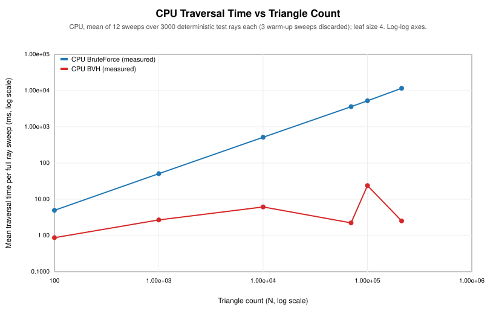
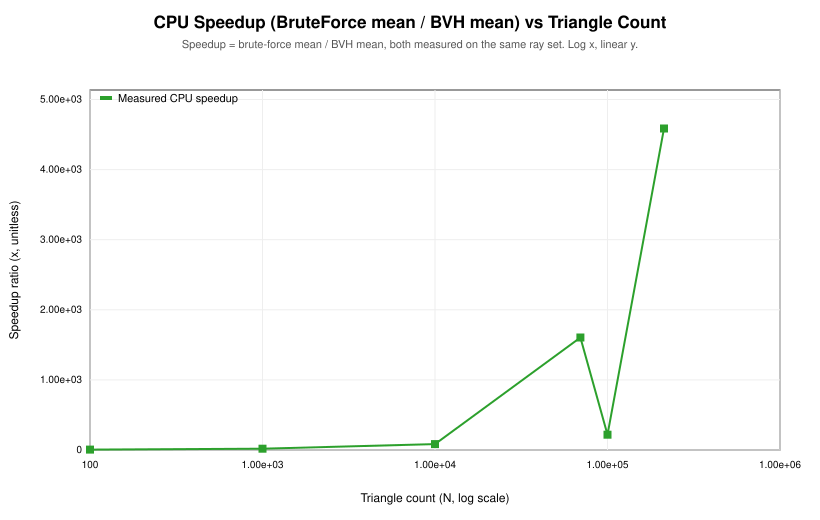
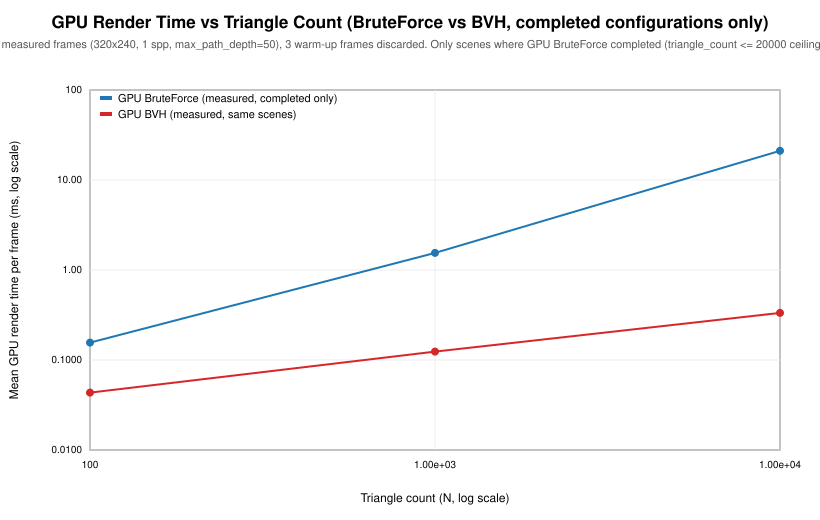
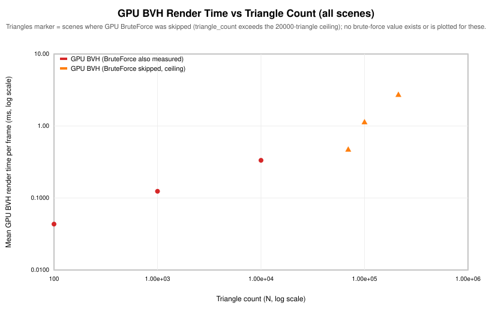
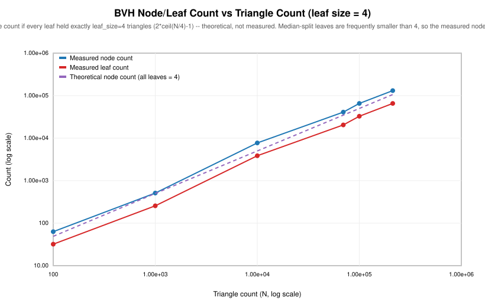
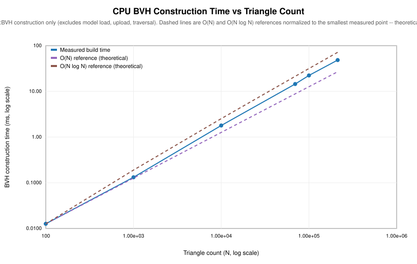
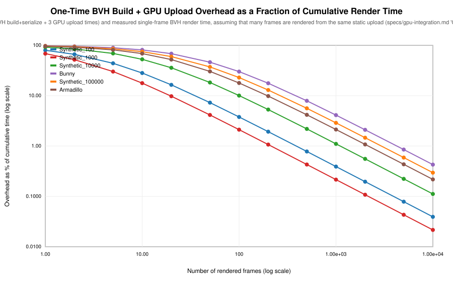

# M10 — BVH Analysis / Interpretation

## Status: M10 complete (analysis record; no rendering, traversal, or BVH code changed)

This document analyzes the M9 benchmark dataset committed at
`Benchmark/Results/benchmark_results.csv` (24 rows, one full run:
`./build/Benchmark/Benchmark`, no flags, run timestamp
`2026-09-20T22:04:47Z`). It does not add, remove, or alter any benchmark
measurement, and it does not modify `Core`, `App`, or `Benchmark`. All
numbers below are read or derived directly from that CSV by the reproducible
script `Analysis/Source/generate_analysis.py`; nothing is hand-entered.

**Hardware note (read before the rest of this document):** this run was
executed on a machine with an **NVIDIA GeForce RTX 3050 Ti Laptop GPU**
(`GL_VENDOR=NVIDIA Corporation`, driver `4.6.0 NVIDIA 595.71.05`). An earlier
internal run of the same benchmark tool used a different GPU (an AMD
Radeon Graphics integrated GPU, `radeonsi`/`renoir`/Mesa). That earlier run
is **fully superseded** by the dataset analyzed here. Every GPU number,
table, and plot in this document comes exclusively from the NVIDIA run; no
AMD GPU measurement is combined, averaged, or compared side-by-side with an
NVIDIA measurement anywhere in this analysis. Where the earlier AMD-based
finding differs qualitatively from this NVIDIA-based finding, that
difference is called out explicitly (see §6.3) rather than silently
overwritten, because it is itself a measured, hardware-dependent
observation. CPU numbers in this document are taken from this same latest
run (the CSV's CPU and GPU rows share one run/timestamp); see §8 for a note
on what is and is not known about the CPU hardware across runs.

To regenerate every table and plot referenced here from the committed CSV:

```
python3 Analysis/Source/generate_analysis.py
```

This writes `Analysis/Results/tables/*.csv` and `Analysis/Results/plots/*.svg`.
The script has no third-party dependencies (stdlib `csv`/`math` only, plus a
small local SVG renderer in `Analysis/Source/svgplot.py`), consistent with
this project's general preference to avoid adding dependencies for narrow,
one-off tooling.

Throughout this document, **measured** refers to a number that appears in
`benchmark_results.csv` or is a direct arithmetic function of numbers that
appear there (difference, ratio, percentage, coefficient of variation).
**Theoretical** refers to a complexity-class expectation (e.g. `O(N)`,
`O(log N)`) used only as a reference to compare measured behavior against —
never as a substitute for a missing measurement. `O(log N)` is used only to
describe *tree depth*, which is a structural property of a balanced binary
BVH and is checked directly against measured depth in §4.2; it is never
used in this document to assert that BVH *traversal* itself runs in
`O(log N)` time (see §6.2 for why that distinction matters).

**Methodological framing.** This project implements the same conceptual
acceleration approach — a BVH built once over a static scene and traversed
per ray — on two different execution models: a CPU implementation
(`Core::IntersectBVH`, standard C++ over `std::vector`-backed nodes) and a
GPU implementation (a GLSL compute shader traversing a flattened,
`std430`-compatible node/primitive layout uploaded to storage buffers,
`specs/gpu-integration.md`). Both are compared against their own respective
brute-force reference (`Core::IntersectBruteForce` on the CPU,
`hitTriangles()` linear scan on the GPU) using representation-appropriate
inputs, rather than assuming the two platforms are interchangeable. This
lets the dataset speak to two related but distinct questions: whether the
BVH accelerates traversal relative to brute force *on each platform*
(§2, §3), and whether the *same* BVH-vs-N behavior generalizes across
platforms and hardware (§6.3) — which, per §6.3, it only partially does.
Before any performance comparison is trusted, both traversal paths are
verified to produce matching results against their own brute-force
reference (§7): 18,000 individual CPU ray comparisons across all six
scenes with 0 mismatches, bit-exact GPU pixel comparisons for the three
scenes where both GPU modes completed, and a BVH structure that is
deterministic and byte-identical regardless of which GPU is installed.

---

## 1. Experimental dataset overview

Source: `Benchmark/Results/benchmark_results.csv`, produced by
`./build/Benchmark/Benchmark` (full run, not `--quick`). GPU:
`NVIDIA GeForce RTX 3050 Ti Laptop GPU/PCIe/SSE2`, vendor `NVIDIA
Corporation`, GL version `4.6.0 NVIDIA 595.71.05`. Run timestamp
`2026-09-20T22:04:47Z`. The CSV contains exactly 24 rows: 12 CPU rows (6
scenes × {BruteForce, BVH}) and 12 GPU rows (6 scenes × {BruteForce, BVH}).

| Scene | Kind | Triangle count |
|---|---|---|
| `Synthetic_100` | synthetic (generated, seed 1001) | 100 |
| `Synthetic_1000` | synthetic (generated, seed 1002) | 1,000 |
| `Synthetic_10000` | synthetic (generated, seed 1003) | 10,000 |
| `Bunny` | real-world (`App/Assets/bunny.obj`) | 69,630 |
| `Synthetic_100000` | synthetic (generated, seed 1004) | 100,000 |
| `Armadillo` | real-world (`App/Assets/armadillo.obj`) | 212,574 |

(Ordered here by ascending triangle count, not benchmark run order, because
`Bunny`'s 69,630 triangles fall between `Synthetic_10000` and
`Synthetic_100000`. This is the actual measured triangle count of the two
real-world models used, from `Core::Mesh::GetTriangleCount()`, not a rounded
or nominal figure. Triangle counts and BVH structure are unaffected by which
GPU ran the benchmark — see §4.)

Controlled configuration, shared by every row unless stated otherwise
(`specs/benchmarking.md` "Controlled Parameters"):

- BVH leaf size: 4 (`Core::BVH::DefaultLeafSize`) on every BVH row.
- CPU: 3,000 deterministic test rays per scene, 3 warm-up sweeps (discarded),
  12 measured sweeps, `tMin=0.001`, `tMax=FLT_MAX`.
- GPU: 320×240 resolution, 1 sample per pixel, `max_path_depth=50`
  (hardcoded shader constant, recorded not swept — see Limitations), 3
  warm-up frames (discarded), 10 measured frames, `u_SphereCount=0`,
  `u_FrameIndex=0` fixed for every dispatch.
- GPU brute-force ceiling: 20,000 triangles (`GpuBenchmarkConfig::MaxBruteForceTriangles`),
  unchanged from the earlier AMD run — see §8 (this constant was not
  re-tuned for the new GPU).

Row-status breakdown: 21 rows `ok`, 3 rows `skipped` (GPU BruteForce for
`Synthetic_100000`, `Bunny`, `Armadillo` — all three exceed the 20,000
triangle ceiling), 0 `timeout`, 0 `error`. Identical breakdown to the
previous run — the ceiling is a fixed triangle-count constant, so which
scenes get skipped does not depend on which GPU ran the benchmark.

---

## 2. CPU results

### 2.1 BruteForce vs BVH, all six scenes (all valid — every CPU row is `ok`)

Source: `Analysis/Results/tables/cpu_bruteforce_vs_bvh.csv`. `bf`/`bvh` mean
is the mean time for one full sweep over the same 3,000 test rays
(`n=12` measured sweeps each).

| Scene | N | BF mean (ms) | BF CoV | BVH mean (ms) | BVH CoV | Abs. diff (ms) | Speedup (×) | Relative reduction |
|---|---|---|---|---|---|---|---|---|
| Synthetic_100 | 100 | 4.9554 | 2.58% | 0.8698 | 3.75% | 4.0857 | **5.70×** | 82.45% |
| Synthetic_1000 | 1,000 | 50.9296 | 0.86% | 2.6959 | 2.04% | 48.2337 | **18.89×** | 94.71% |
| Synthetic_10000 | 10,000 | 513.9154 | 1.00% | 6.1437 | 3.32% | 507.7717 | **83.65×** | 98.81% |
| Bunny | 69,630 | 3582.4415 | 0.15% | 2.2315 | 14.30% | 3580.2100 | **1605.37×** | 99.94% |
| Synthetic_100000 | 100,000 | 5227.4037 | 0.83% | 23.9317 | 12.67% | 5203.4720 | **218.43×** | 99.54% |
| Armadillo | 212,574 | 11561.2219 | 0.33% | 2.5212 | 12.75% | 11558.7007 | **4585.64×** | 99.98% |

CoV = coefficient of variation = `stddev / mean`, computed per row from the
CSV's own `measurement_stddev_ms` / `measurement_mean_ms`, over `n=12` sweeps.





**Observations (measured, not assumed):**

- BruteForce mean time grows monotonically with triangle count across the
  four synthetic scenes and scales almost exactly linearly with N, as
  expected for an `O(N)` per-ray scan: 4.96 → 50.93 → 513.92 → 5227.40 ms as
  N goes 100 → 1,000 → 10,000 → 100,000 (each 10× step in N produces a
  10.1×–10.3× step in time — a very clean linear match). Bunny (69,630 tri,
  3582.44 ms) and Armadillo (212,574 tri, 11561.22 ms) fall in
  between/above these consistent with their triangle counts. This is
  consistent with the expected behavior of brute-force traversal: every ray
  tests every triangle, so triangle count dominates traversal cost rather
  than the spatial organization of the scene.
- BVH mean time is **not** monotonic in the same simple way. It grows only
  from 0.87 → 2.70 → 6.14 ms as N goes 100 → 1,000 → 10,000. This growth is
  clearly sub-linear relative to N, which is consistent with the
  hierarchical pruning provided by the BVH (a balanced binary tree over N
  primitives has `O(log N)` *depth* — see §4.2 — but a single ray's
  traversal can still visit multiple branches whose bounding volumes it
  overlaps, and its actual node/triangle visit count is data- and
  ray-dependent; in the worst case a ray can visit a large fraction of the
  tree, approaching `O(N)`). This sub-linear measurement is evidence that
  the BVH is pruning effectively on these scenes; it is not, by itself,
  proof that CPU BVH traversal has `O(log N)` time complexity in general.
  The picture is further complicated by real-world meshes: Bunny (69,630
  tri) measures **faster** (2.23 ms) than Synthetic_10000 (10,000 tri,
  6.14 ms) despite having ~7× more triangles, and Armadillo's measured CPU
  BVH traversal time (2.52 ms) is approximately 9.5× lower than
  Synthetic_100000's (23.93 ms) despite Armadillo containing more than
  twice as many triangles. This is the clearest evidence in this dataset
  that **BVH traversal cost depends on scene/ray structure, not just N**,
  and it reproduces (with very similar magnitude) the same pattern observed
  in the earlier AMD-hosted run — see §6.3.
- Every CPU speedup ratio in this dataset is real: both the BruteForce and
  BVH mean come from a completed, `ok` measurement on the identical ray set
  and identical mesh (`specs/bvh.md` "Correctness Requirement" is satisfied
  first — see §7 — so the speedup is not being computed from a
  BVH-produces-wrong-answer shortcut). Speedup increases with N for the
  synthetic scenes (5.70× → 18.89× → 83.65×), consistent with a fixed BVH
  traversal cost overhead mattering more at small N. The two real-world
  models show the largest speedups (1605.37× and 4585.64×) in this dataset,
  but per the point above this is a combination of large N *and* favorable
  (compact, connected) scene structure, not N alone — Synthetic_100000 has a
  smaller speedup (218.43×) than Bunny despite having more triangles.

### 2.2 Measurement noise (CoV)

BruteForce CoV stays under 2.6% for every scene — an `O(N)` linear scan over
a `std::vector` has very little run-to-run variance. BVH CoV is
consistently higher (2.04%–14.30%) and does **not** shrink with N; the
three highest CoVs in the whole CPU dataset belong to the three
**largest**-N scenes — Bunny (14.30%), Armadillo (12.75%), and
Synthetic_100000 (12.67%) — while the three smaller synthetic scenes
(3.75%, 2.04%, 3.32%) are markedly less noisy. Because a BVH sweep touches
far fewer memory locations per ray than a brute-force sweep, its absolute
duration is smaller and more sensitive to system-level noise (cache state,
scheduler jitter, thermal/frequency scaling) relative to its own mean —
this is an expected characteristic of measuring short-duration operations,
not a defect in the benchmark. These are single-machine, non-isolated (no
CPU pinning, no `nice`, no isolated core) measurements; see §8.

---

## 3. GPU results

### 3.1 BruteForce vs BVH — only for configurations where BOTH completed

Source: `Analysis/Results/tables/gpu_bruteforce_vs_bvh.csv`. GPU BruteForce
was attempted for every scene but the harness **skips** (never dispatches)
it outright above the 20,000-triangle ceiling — this is a `status=skipped`
row with `measurement_mean_ms=0.0`, which is a placeholder, not a real zero
timing, and is excluded from this comparison entirely.

| Scene | N | GPU BF mean (ms) | BF CoV | GPU BVH mean (ms) | BVH CoV | Abs. diff (ms) | Speedup (×) | Relative reduction | Pixel check |
|---|---|---|---|---|---|---|---|---|---|
| Synthetic_100 | 100 | 0.1559 | 0.42% | 0.0434 | 1.22% | 0.1124 | **3.59×** | 72.14% | passed, max\|Δ\|=0.0 |
| Synthetic_1000 | 1,000 | 1.5487 | 0.22% | 0.1239 | 1.46% | 1.4248 | **12.50×** | 92.00% | passed, max\|Δ\|=0.0 |
| Synthetic_10000 | 10,000 | 21.0943 | 0.34% | 0.3337 | 4.81% | 20.7606 | **63.21×** | 98.42% | passed, max\|Δ\|=0.0 |

Only these three scenes have a valid GPU BruteForce measurement, so only
these three rows admit a genuine speedup calculation. Every value in the
"Pixel check" column is a real measured cross-check (`GpuBenchmark.cpp`'s
`ComparePixels`, over the full 320×240×4-channel accumulation buffer, `1e-4`
tolerance), not an assumption — see §7.2.



### 3.2 GPU BruteForce ceiling and skipped cases

Source: `Analysis/Results/tables/gpu_bvh_only_brute_force_skipped.csv`.

| Scene | N | GPU BruteForce status | GPU BVH mean (ms) |
|---|---|---|---|
| Bunny | 69,630 | **skipped** (exceeds 20,000-triangle ceiling) | 0.4747 |
| Synthetic_100000 | 100,000 | **skipped** (exceeds 20,000-triangle ceiling) | 1.1385 |
| Armadillo | 212,574 | **skipped** (exceeds 20,000-triangle ceiling) | 2.7394 |

No speedup, no absolute difference, and no relative reduction is reported
for these three scenes, and none should be inferred: there is no GPU
BruteForce time to compare against. `benchmark_results.csv` itself already
encodes this correctly (`measurement_mean_ms=0.0` with `status=skipped`, not
a timing) — this analysis preserves that distinction rather than treating
the `0.0` placeholder as "fast."

`GpuBenchmarkConfig::MaxBruteForceTriangles = 20000` is a fixed, hand-picked
constant carried over unchanged from the earlier AMD-hosted run (M9,
`specs/milestones.md`) — it was **not** re-derived or re-tuned for this
NVIDIA GPU. What this dataset *does* support as an experimental observation
on this specific GPU/driver: GPU BruteForce cost at 10,000 triangles is
already ~21.1 ms/frame at only 320×240/1 spp (§3.1), comfortably inside the
15s per-iteration wait budget. Because the fixed 20,000-triangle ceiling was
not revisited for this GPU, it is possible that it is more conservative
than strictly necessary on this hardware — i.e., GPU BruteForce might well
have completed at 100,000 triangles or beyond on this GPU within a
reasonable time — but this was never measured at any larger triangle count
on this GPU, and no such number, and no comparison against the AMD-hosted
run's brute-force timings, is stated anywhere in this document. No
extrapolated number (e.g. "brute force would take X ms at 100,000 triangles
on this GPU") is stated anywhere, because it was never measured.



### 3.3 GPU BVH across all six scenes

Unlike the CPU results (§2.1) and unlike the earlier AMD-hosted GPU run,
GPU BVH mean time on this NVIDIA GPU is **monotonically increasing** with
triangle count across all six scenes in ascending-N order:

| Scene | N | GPU BVH mean (ms) |
|---|---|---|
| Synthetic_100 | 100 | 0.0434 |
| Synthetic_1000 | 1,000 | 0.1239 |
| Synthetic_10000 | 10,000 | 0.3337 |
| Bunny | 69,630 | 0.4747 |
| Synthetic_100000 | 100,000 | 1.1385 |
| Armadillo | 212,574 | 2.7394 |

The *rate* of growth is not uniform, though. From 100 to 10,000 triangles
(the synthetic-only range) growth is clearly sub-linear (each 10× step in N
produces only a 2.7×–2.9× step in time). From Synthetic_10000 (10,000 tri)
to Bunny (69,630 tri, a 6.96× increase in N) time increases only 1.42×
(0.3337 → 0.4747 ms) — still strongly sub-linear, i.e. still consistent
with a real-world mesh traversing more efficiently per triangle than the
scattered synthetic geometry. But from Bunny (69,630 tri) to
Synthetic_100000 (100,000 tri, only a 1.44× increase in N) time increases
2.40× (0.4747 → 1.1385 ms), and from Synthetic_100000 to Armadillo
(212,574 tri, a 2.13× increase in N) time increases 2.41× (1.1385 →
2.7394 ms) — both **slightly super-linear** relative to N. This is a
materially different picture from §2.1's CPU numbers (measured on the same
machine, in the same run) and from the earlier AMD-hosted GPU run, where
the equivalent large-scene comparisons (Armadillo vs. Synthetic_100000)
showed Armadillo rendering in essentially the *same* time despite having
roughly double the triangles. On this NVIDIA GPU, that specific "beats N"
effect is not reproduced at the largest scale — see §6.3 for the full
comparison across CPU/GPU and across both GPU runs.

### 3.4 GPU measurement noise

CoV is low across the board on this GPU — noticeably lower than the
earlier AMD-hosted run at every scene. BruteForce CoV ranges only
0.22%–0.42% for the three valid pairs. BVH CoV ranges 1.22%–4.81% for those
same three scenes, with **Synthetic_10000 the noisiest of the three**
(4.81%), not the smallest scene as in the previous run. For the three
scenes where only GPU BVH was measured, CoV is 2.57% (Bunny), 2.00%
(Synthetic_100000), and 0.42% (Armadillo) — all modest. No GPU row in this
dataset shows the kind of extreme (tens-of-percent) CoV that the smallest
scene showed on the previous AMD iGPU; this discrete GPU's `GL_TIME_ELAPSED`
measurements are substantially more stable at short frame times on this
hardware/driver combination. The qualitative conclusion (BVH faster than
BruteForce at every triangle count with a valid pair) is well-supported
here: for all three scenes, every individual BVH sample's range sits
entirely below every individual BruteForce sample's range (e.g.
Synthetic_100: BVH max = 0.044032 ms, BruteForce min = 0.154624 ms — no
overlap).

---

## 4. BVH structural analysis

Source: `Analysis/Results/tables/bvh_structure.csv` (leaf size 4 throughout
this dataset). `Core::BVH` construction strategy, per `specs/bvh.md`: binary
BVH, centroid-based median split, largest-centroid-extent axis selection,
configurable leaf size (4 here), degenerate-split fallback to a leaf. This
is evaluated as *the implemented median-split strategy* — no claim of
optimality is made anywhere below.

**Reproducibility note:** every field in this section is **byte-identical**
between this NVIDIA-hosted run and the earlier AMD-hosted run. `Core::BVH`
construction depends only on mesh geometry, leaf size, and the algorithm
itself — none of which depend on which GPU (or which machine) ran the
benchmark. This is expected and is itself a useful confirmation that the
CPU-side construction is deterministic and hardware-independent, unlike the
*timings* in §5.1, which do vary slightly between runs.

| Scene | N | Leaf size | Node count | Leaf count | Max depth | Min/Max/Avg leaf size |
|---|---|---|---|---|---|---|
| Synthetic_100 | 100 | 4 | 63 | 32 | 5 | 3 / 4 / 3.125 |
| Synthetic_1000 | 1,000 | 4 | 511 | 256 | 8 | 3 / 4 / 3.906 |
| Synthetic_10000 | 10,000 | 4 | 7,711 | 3,856 | 12 | 2 / 4 / 2.593 |
| Bunny | 69,630 | 4 | 40,955 | 20,478 | 15 | 2 / 4 / 3.400 |
| Synthetic_100000 | 100,000 | 4 | 65,535 | 32,768 | 15 | 3 / 4 / 3.052 |
| Armadillo | 212,574 | 4 | 131,071 | 65,536 | 16 | 3 / 4 / 3.244 |

### 4.1 Binary-tree invariant (structural sanity check, not new algorithmic work)

For every scene, `node_count == 2 × leaf_count − 1`, which is a structural
property of any binary tree in which every internal node has exactly two
children (leaf_count = internal_count + 1) — already documented and tested
at construction time in M5. This is confirmed to hold for every single row
in the dataset, which is a basic consistency check on the recorded
statistics themselves, not a new claim about tree quality.

### 4.2 Depth vs the median-split theoretical expectation

Centroid-median partitioning always splits a range of `count` primitives
into two halves of size `⌈count/2⌉` and `⌊count/2⌋`; that halving bounds the
theoretical maximum depth at `⌈log2(N / leafSize)⌉`, ignoring the small
constant-depth effect of leaves that stop early for other reasons (this is
the same reasoning `specs/milestones.md` M8 used to size the GPU traversal
stack).

| Scene | N | Measured max depth | ⌈log2(N/4)⌉ (theoretical) | Difference |
|---|---|---|---|---|
| Synthetic_100 | 100 | 5 | 5 | 0 |
| Synthetic_1000 | 1,000 | 8 | 8 | 0 |
| Synthetic_10000 | 10,000 | 12 | 12 | 0 |
| Bunny | 69,630 | 15 | 15 | 0 |
| Synthetic_100000 | 100,000 | 15 | 15 | 0 |
| Armadillo | 212,574 | 16 | 16 | 0 |

Measured max depth matches the theoretical `⌈log2(N/leafSize)⌉` bound
**exactly** for all six scenes in this dataset. This is a clean, direct
confirmation that the construction algorithm behaves as designed (a
deterministic median split that halves the primitive range at every level)
— it is a validation of construction mechanics, not a performance claim.

### 4.3 Leaf count and packing efficiency

If every leaf held exactly `leafSize=4` triangles, the theoretical minimum
leaf count would be `⌈N/4⌉`. The measured leaf count is always higher than
this minimum, because median partitioning splits by *count*, not by a
packing-aware rule, and the leaf condition (`count ≤ leafSize`) triggers a
leaf as soon as a range becomes small enough — it does not try to merge
small ranges into fewer, fuller leaves.

| Scene | N | Measured leaf count | ⌈N/4⌉ (theoretical minimum) | Ratio |
|---|---|---|---|---|
| Synthetic_100 | 100 | 32 | 25 | 1.28× |
| Synthetic_1000 | 1,000 | 256 | 250 | 1.02× |
| Synthetic_10000 | 10,000 | 3,856 | 2,500 | 1.54× |
| Bunny | 69,630 | 20,478 | 17,408 | 1.18× |
| Synthetic_100000 | 100,000 | 32,768 | 25,000 | 1.31× |
| Armadillo | 212,574 | 65,536 | 53,144 | 1.23× |

This ratio is **not monotonic in N** (it is 1.02× at 1,000 triangles but
1.54× at 10,000), which shows that median-split leaf packing efficiency for
this construction strategy is sensitive to exactly how the recursive halving
lands relative to the leaf-size cutoff at a given N, not a smooth function
of N alone. `Synthetic_100000` (32,768 leaves) and `Armadillo` (65,536
leaves) both land on exact powers of two, which is a property of how many
times a range of that particular size divides evenly by 2 before hitting
the leaf-size floor, not evidence of a better tree. No causal claim beyond
"the measured ratio is not monotonic" is made here — the median-split
algorithm is deterministic but its interaction with a specific N is not
simply proportional.

### 4.4 Relating structure to measured performance

Two scenes with almost the same `average_leaf_size` (Synthetic_100000: 3.05,
Armadillo: 3.24) and comparable node counts (65,535 vs 131,071 — Armadillo
has roughly double) show very different CPU outcomes: Armadillo's measured
CPU BVH traversal time (2.52 ms) is approximately 9.5× lower than that of
Synthetic_100000 (23.93 ms, §2.1), despite Armadillo containing more than
twice as many triangles. On the GPU, the same pair no longer shows this
advantage — Armadillo (2.7394 ms) is *slower* than Synthetic_100000
(1.1385 ms) by almost exactly the triangle-count ratio (§3.3).

This is a **measured fact**: average leaf size and node count alone — i.e.,
the flat structural statistics in this table — do not explain either
outcome. A plausible **hypothesis**, consistent with the numbers but not
directly verified by them, is that it comes from how the *rays* interact
with the tree shape (i.e., how many nodes a typical ray actually visits).
This benchmark does not record that quantity — there is no per-ray
node/AABB/triangle visit-count instrumentation in `Core::IntersectBVH` or
the GPU traversal shader — so this dataset establishes a **correlation**
between scene structure and traversal time, not a direct measurement of
node-visit counts as the causal mechanism. It is also notable that this
ray-tree interaction, whatever its precise mechanism, is evidently not
identical between the CPU and GPU traversal paths for this pair of scenes.
This is flagged as an open question this dataset cannot fully resolve — see
§6.3 and §9.



---

## 5. Construction / upload overhead analysis

This section covers three **separately measured** costs: CPU-side
`Core::BVH` construction (§5.1), CPU-side preparation/serialization of that
BVH into the flat arrays the GPU path uploads (included in the GPU rows'
`bvh_build_ms`, per M9's definition — §5.3), and GPU buffer uploads over
PCIe (§5.2). None of these three is per-frame traversal/render cost, and
they are analyzed here **separately** from it, per `specs/benchmarking.md`'s
"never merge them into a single number." §5.3 sums the three into a single
`Total one-time overhead` figure, but only for the specific purpose of the
amortization analysis in §5.3–§5.4: because this project's static-scene
implementation performs all three exactly once (build, serialize, upload)
and reuses the resulting BVH and GPU buffers across every subsequent frame
(`specs/gpu-integration.md` "GPU Data Lifecycle"), it is meaningful to ask
how many frames it takes for their combined, one-time cost to become
negligible relative to cumulative render time. The sum itself is a derived
quantity constructed for that amortization question — it is not a claim
that construction, serialization, and upload are the same kind of
operation, and each is still reported individually in §5.1–§5.2.

### 5.1 CPU-only construction time (`Core::BVH` construction, no serialization/upload)

Source: CPU rows' `bvh_build_ms`.

| Scene | N | Build time (ms) | Build time per triangle (µs) |
|---|---|---|---|
| Synthetic_100 | 100 | 0.0127 | 0.127 |
| Synthetic_1000 | 1,000 | 0.1317 | 0.132 |
| Synthetic_10000 | 10,000 | 1.7905 | 0.179 |
| Bunny | 69,630 | 14.4915 | 0.208 |
| Synthetic_100000 | 100,000 | 22.3385 | 0.223 |
| Armadillo | 212,574 | 48.4352 | 0.228 |

Per-triangle cost grows slowly (0.127 → 0.228 µs/triangle across a 1,000×
increase in N), consistent with the expected `O(N log N)` construction cost
(a `std::nth_element` median partition per level, `O(log N)` levels) rather
than pure `O(N)` — the dashed reference curves on the plot below make this
comparison explicit and are clearly theoretical, not measured. These
absolute build times are close to, but not identical to, the earlier
AMD-hosted run's construction times (e.g. Armadillo: 48.44 ms here vs.
52.13 ms previously) — expected, since construction *time* (unlike the
structural statistics in §4) is an ordinary wall-clock measurement subject
to normal run-to-run noise even though the algorithm itself is
deterministic.



### 5.2 GPU upload times (measured separately from render time)

Source: GPU BVH rows' `gpu_triangle_upload_ms`, `gpu_bvh_node_upload_ms`,
`gpu_bvh_primitive_upload_ms`. Each wraps one `Renderer::CreateStorageBuffer`
call followed by `glFinish()` (M9), so these are upload-completion times,
**not** GPU traversal time — they are reported here strictly as overhead.

| Scene | N | Triangle upload (ms) | BVH node upload (ms) | BVH primitive upload (ms) |
|---|---|---|---|---|
| Synthetic_100 | 100 | 0.1224 | 0.0233 | 0.0115 |
| Synthetic_1000 | 1,000 | 0.0331 | 0.0262 | 0.0124 |
| Synthetic_10000 | 10,000 | 0.6746 | 0.0852 | 0.2588 |
| Bunny | 69,630 | 1.1352 | 1.7267 | 0.1831 |
| Synthetic_100000 | 100,000 | 2.8496 | 2.3495 | 0.2605 |
| Armadillo | 212,574 | 4.3652 | 4.5793 | 0.7230 |

Triangle upload time is **not** monotonic at the low end, reproducing the
same pattern observed on the previous GPU: Synthetic_100 (100 triangles)
took 0.1224 ms, **more** than Synthetic_1000 (0.0331 ms), a 10× larger
buffer. This is evidence of a fixed per-call driver/allocation overhead
dominating actual data-size cost for very small buffers on this GPU/driver
too; it should not be read as "smaller buffers upload slower," only as
"fixed overhead is not negligible at this scale on this driver" — and
apparently on more than one driver/vendor combination, since the same
qualitative non-monotonicity appears on both GPUs tested for this project.

### 5.3 One-time overhead vs a single frame's render time

Source: `Analysis/Results/tables/gpu_construction_upload_overhead.csv`.
`Total one-time overhead` = GPU-row `bvh_build_ms` (CPU construction +
serialization into the GPU upload arrays, per M9's definition) + the three
upload times above. `Single-frame render` is the same GPU BVH row's
`measurement_mean_ms`.

| Scene | N | Total one-time overhead (ms) | Single-frame render (ms) | Overhead ÷ 1 frame |
|---|---|---|---|---|
| Synthetic_100 | 100 | 0.1704 | 0.0434 | 3.93× |
| Synthetic_1000 | 1,000 | 0.2675 | 0.1239 | 2.16× |
| Synthetic_10000 | 10,000 | 3.7286 | 0.3337 | 11.17× |
| Bunny | 69,630 | 20.3700 | 0.4747 | 42.91× |
| Synthetic_100000 | 100,000 | 33.8140 | 1.1385 | 29.70× |
| Armadillo | 212,574 | 59.5834 | 2.7394 | 21.75× |

For every scene, the one-time build+upload cost is **larger than a single
frame's render time** — by up to a factor of ~43× for Bunny. On this GPU,
`Total one-time overhead` (which is dominated by CPU-side BVH construction
and PCIe upload, not GPU shader execution — §5.1, §5.2) is a similar order
of magnitude to the earlier AMD-hosted run's equivalent overhead figures
(construction and upload are largely CPU/PCIe-bound, so this is expected),
while `Single-frame render` is markedly lower than on the earlier run,
because this GPU's shader execution is faster. Their ratio is therefore
larger here than it was previously; the two per-run ratios are each
computed entirely from that run's own single-vendor measurements and are
not combined into a single cross-vendor figure. Taken in isolation, and
only for a single frame, this would look like the BVH's overhead outweighs
its benefit by an even larger margin than a slower GPU would show. That
framing is specific to "render exactly one frame," which is not this
project's target use case (`specs/gpu-integration.md`'s "GPU Data Lifecycle":
build once, render many frames for a **static** scene; `specs/AGENTS.md`:
"The BVH should not be rebuilt during every render frame for static
geometry").

### 5.4 Amortization over many frames (derived, not separately measured)

The following is a direct arithmetic projection from the two already-measured
numbers above (`overhead / (overhead + frames × per_frame_render)`), assuming
the same static upload is reused for every frame, which is exactly how
`AppLayer` already uses the BVH (build once in the constructor, bind/render
every `OnRender()` call, per `specs/gpu-integration.md`). This is **not** a
new measurement — no additional frames were rendered or timed to produce it.

| Scene | N | Frames until overhead ≤ 10% of cumulative time | Frames until overhead ≤ 1% |
|---|---|---|---|
| Synthetic_100 | 100 | 36 | 389 |
| Synthetic_1000 | 1,000 | 20 | 214 |
| Synthetic_10000 | 10,000 | 101 | 1,107 |
| Bunny | 69,630 | 387 | 4,248 |
| Synthetic_100000 | 100,000 | 268 | 2,941 |
| Armadillo | 212,574 | 196 | 2,154 |

Because the per-frame render time on this GPU is smaller relative to the
one-time overhead (§5.3), this table's frame counts are larger than the
equivalent frame counts computed the same way from the earlier AMD-hosted
run's own (single-vendor) numbers. Even so, at typical interactive frame
rates (tens of frames per second), a few hundred frames is a few seconds —
the largest figure in this table (Bunny, 4,248 frames for the 1% threshold)
is still under two minutes at 60 fps, and well under that for the 10%
threshold used by most rows.
This still quantifies, from the measured data, why a per-frame rebuild
would be wasteful for a static scene and why a one-time build is the
appropriate choice **for this project's static-scene use case** — it is not
a claim that construction cost is universally negligible; a workload that
rebuilds the BVH every frame (e.g. fully dynamic geometry, explicitly out
of scope per `specs/project.md` "Non-Goals": "Dynamic BVH refitting") would
see this overhead on every single frame instead of once, and would need
comparatively more frames to reach the same amortized fraction on faster
GPU hardware than on slower hardware, because rendering itself got cheaper
while the one-time cost did not shrink proportionally.



### 5.5 Model loading time (context, not part of the traversal comparison)

| Scene | N | Model load / generate time (ms) |
|---|---|---|
| Synthetic_100 | 100 | 0.0244 |
| Synthetic_1000 | 1,000 | 0.1010 |
| Synthetic_10000 | 10,000 | 0.9816 |
| Bunny | 69,630 | 55.8501 |
| Synthetic_100000 | 100,000 | 8.7619 |
| Armadillo | 212,574 | 162.5126 |

Real-model OBJ import (Bunny: 55.85 ms / 69,630 tri ≈ 0.80 µs/tri;
Armadillo: 162.51 ms / 212,574 tri ≈ 0.76 µs/tri) costs roughly an order of
magnitude more per triangle than synthetic procedural generation
(Synthetic_100000: 8.76 ms / 100,000 tri ≈ 0.088 µs/tri) — expected, since
OBJ import involves text parsing (`Core::ImportObjFile`) rather than direct
in-memory vertex generation. This is a CPU-only measurement, unaffected by
which GPU ran the benchmark. Per `specs/benchmarking.md`, this is reported
as its own category and is excluded from every BVH/traversal timing above.

---

## 6. Scaling behavior

### 6.1 CPU brute force: linear in N (measured)

Already shown in §2.1: BruteForce mean time tracks N very closely across
the synthetic scenes (100→1,000→10,000→100,000 triangles maps to
4.96→50.93→513.92→5227.40 ms; each 10× increase in N produces a
10.1×–10.3× increase in time). This matches the `O(N)`-per-ray expectation
stated in `specs/bvh.md` ("brute-force traversal performs O(N) triangle
intersection tests per ray") — stated here as a measured confirmation of
that expectation, not a new derivation.

### 6.2 CPU/GPU BVH: sub-linear in N for a fixed scene generator

Within the synthetic-only progression (100 → 1,000 → 10,000 → 100,000):

- CPU BVH mean time grows 0.87 → 2.70 → 6.14 → 23.93 ms — each 10× step in
  N produces roughly a 2.3×–3.9× step in time, clearly sub-linear.
- GPU BVH mean time grows 0.0434 → 0.1239 → 0.3337 → 1.1385 ms — each 10×
  step in N produces roughly a 2.7×–3.4× step in time, also clearly
  sub-linear, and of a similar magnitude to the CPU numbers.

**On terminology:** a balanced binary BVH over N primitives has `O(log N)`
*depth* — this is a structural property, confirmed directly for this
implementation in §4.2. That is not the same claim as "BVH traversal has
`O(log N)` time complexity." A single ray's traversal visits one or more
paths through the tree, and how many nodes and leaves it actually tests
depends on the ray's direction, origin, and how many bounding volumes it
happens to overlap — in the worst case (e.g. a ray that grazes many
sibling bounding volumes) traversal can visit a large fraction of all
nodes, approaching `O(N)`. The measured growth above is sub-linear over the
synthetic sequence, which is consistent with the hierarchical pruning
provided by the BVH (`specs/bvh.md`: "BVH traversal is intended to reduce
the number of triangle intersection tests by rejecting groups of triangles
through AABB tests... actual performance must be measured rather than
assumed" — this dataset is that measurement of *effective, observed*
behavior on these six scenes). It does **not** prove that CPU or GPU BVH
traversal has `O(log N)` time complexity in general, and no such complexity
claim is made anywhere in this document. This clean sub-linear trend is
also **only observed within one scene-generation method**; §6.3 shows it
does not extend uniformly once real-world models are included, and does so
differently on the CPU than on this GPU.

### 6.3 Scene/ray structure effect: strongly reproduced on CPU, only partially on this GPU

This section is the most important update relative to the earlier
AMD-hosted analysis. The earlier document reported a single, cleanly
cross-validated finding ("BVH traversal time depends on scene/ray
structure, not N alone," observed on **both** CPU and GPU). With this
NVIDIA-hosted run, that finding **still holds strongly on the CPU** — in
fact it is now the most consistent result in the entire dataset, confirmed
independently across two different runs — but is only **partially**
reproduced on the (new) GPU.

**CPU (this run):**

- Bunny (69,630 tri) traverses in 2.2315 ms — only 36.3% of Synthetic_10000's
  6.1437 ms (10,000 tri), despite having ~7× more triangles.
- Armadillo (212,574 tri) traverses in 2.5212 ms — only 10.5% of
  Synthetic_100000's 23.9317 ms (100,000 tri), despite having ~2.1× more
  triangles.
- Both ratios are close to what the earlier AMD-hosted CPU run measured
  (0.393 and 0.120 respectively) — the effect is reproduced with similar
  magnitude on a second, independent run.

**GPU (NVIDIA, this run):**

- Bunny (69,630 tri, 0.4747 ms) vs. Synthetic_10000 (10,000 tri,
  0.3337 ms): time increases only 1.42× for a 6.96× increase in N — still
  strongly sub-linear/favorable, i.e. the effect is *present* for this
  pair, just not large enough to make Bunny outright faster than the much
  smaller synthetic scene (as it was on both the CPU and on the previous
  AMD GPU).
- Armadillo (212,574 tri, 2.7394 ms) vs. Synthetic_100000 (100,000 tri,
  1.1385 ms): time increases 2.41× for a 2.13× increase in N — essentially
  *proportional* to N, or mildly super-linear. The "beats N" effect that
  was clearly measured for this exact pair on the CPU (§2.1, §4.4) and on
  the previous AMD GPU run is **not** measured here.

To keep what is actually established separate from what is proposed to
explain it, this effect is broken down into three distinct kinds of
statement:

- **Measured fact:** BVH traversal time depends on more than triangle
  count alone. This is directly supported by the numbers above — it does
  not require any explanation to be true, and it holds regardless of which
  mechanism turns out to be responsible.
- **Hypothesis (not directly verified by this dataset):** the synthetic
  scenes (`Benchmark/Source/Scenes.cpp`, `GenerateSyntheticMesh`) are
  independent, randomly placed, non-connected triangles scattered through a
  volume that grows with the cube root of triangle count — there is no
  spatial coherence between neighboring triangles. Bunny and Armadillo are
  single connected real-world meshes where nearby triangles are also nearby
  in space. A plausible explanation is that a ray traversing a BVH over a
  compact, spatially coherent mesh can prune large empty regions quickly,
  while a ray traversing scattered, uncorrelated triangles is more likely
  to cross several separated bounding volumes and visit more nodes before
  reaching a leaf. This is offered as a hypothesis consistent with the
  measured numbers and the known difference between the two scene-
  generation methods, not as an established causal mechanism.
- **Missing measurement:** this benchmark does not instrument per-ray
  node/AABB/triangle visit counts on either the CPU or GPU traversal path.
  Without that instrumentation, this dataset can establish a **correlation**
  between scene structure (synthetic vs. real-world/spatially-coherent) and
  traversal time, but it cannot directly establish that a difference in the
  number of nodes visited per ray is the causal mechanism — that remains an
  untested hypothesis, not a measured result.

That the same effect is measured more weakly on the GPU (and, for the
Armadillo/Synthetic_100000 pair, not measured at all — §3.3) than on the
CPU, and was measured for both pairs on the earlier AMD-hosted GPU, is
itself a **measured fact**: the magnitude, and possibly the presence, of
this effect differs between the two GPUs tested for this project. Candidate
explanations for *why* a GPU might behave differently from the CPU here
(e.g. differences in warp/wavefront occupancy, memory latency hiding, or
dispatch granularity between an integrated and a discrete GPU changing how
much a divergent-vs-coherent traversal pattern costs) are offered strictly
as hypotheses, not as established causes — they are no more directly
verified by this dataset than the CPU-side spatial-coherence hypothesis
above, for the same reason: no per-node visit-count instrumentation exists
to test them (see §8, "BVH structural statistics do not include per-node
visit counts"). This instrumentation was not added in M11: it would require
changing traversal code, which is outside cleanup/documentation scope.

### 6.4 GPU brute force: no scaling claim beyond the measured range

Only three data points exist for GPU brute force on this GPU (100, 1,000,
and 10,000 triangles; §3.1): 0.1559 → 1.5487 → 21.0943 ms. The first 10×
step in N produces a 9.93× step in time (near-perfect `O(N)`); the second
10× step produces a 13.62× step — still broadly `O(N)`-consistent but with
more deviation than the first step. No causal explanation for that specific
deviation is offered here (it could be dispatch/work-group granularity,
driver scheduling, or ordinary noise at this sample size) and no claim is
made about GPU brute-force behavior above 10,000 triangles: those
configurations were never dispatched (§3.2).

---

## 7. Correctness evidence

Kept conceptually and physically separate from every performance number
above, per `specs/bvh.md` ("A faster result is not evidence that the BVH is
correct") and `specs/benchmarking.md` ("Correctness must be verified
independently from performance").

### 7.1 CPU: BruteForce vs BVH per-ray comparison

Every one of the 6 scenes' CPU rows recorded `correctness_checked=true`,
`correctness_passed=true`, `mismatch_count=0`, `tested_ray_count=3000` —
3,000 rays per scene × 6 scenes = **18,000 individual ray comparisons, 0
mismatches**, each checking hit/miss agreement, `TriangleId`, `T` (1e-4
absolute+relative tolerance), `Position`/`Normal` (1e-3 absolute, 1e-4
relative), and `FrontFace` (`Benchmark/Source/CpuBenchmark.cpp`,
`CheckCorrectness`). This check runs once per scene, before any timing loop,
independent of the performance measurements in §2. This is unaffected by
GPU vendor (the CPU path never touches the GPU).

### 7.2 GPU: pixel-level BruteForce vs BVH cross-check

Performed only where both GPU BruteForce and GPU BVH rendered successfully
(i.e., BruteForce was not skipped by the triangle ceiling): Synthetic_100,
Synthetic_1000, Synthetic_10000. For all three, `gpu_pixel_check_performed
=true`, `gpu_pixel_check_passed=true`, `gpu_pixel_max_abs_diff=0.0`,
`gpu_pixel_mismatch_count=0` — a full 320×240×4-channel comparison
(307,200 float values) between the two renders, at exact bit-for-bit
equality in the accumulation buffer (max abs diff is exactly `0.0`, not
merely "within tolerance"). This reproduces, on a second, independent GPU
vendor (NVIDIA, vs. AMD previously), the same bit-exact result the earlier
run found — GPU BruteForce/BVH correctness is not specific to one GPU
vendor in this dataset. For the three scenes where GPU BruteForce was
skipped (Synthetic_100000, Bunny, Armadillo), `gpu_pixel_check_performed
=false` — there is no brute-force reference render to compare against, and
the CSV records this explicitly rather than silently omitting the field.

### 7.3 Existing automated test suite

`Tests` (linking only `Core`, no GL context) reported **114/114** passing as
of M9 (`specs/milestones.md`), unchanged since M6 because no `Core` file was
modified between M6 and M9, and still unmodified as of this update. M10
did not modify `Core`, `App`, or `Benchmark` (see the top of this document
and §"No algorithm changes" in the task scope), so this figure is not
expected to change and was not re-derived by this analysis; it is repeated
here only as the existing correctness evidence this analysis stands on. It
is reported separately from, and should not be conflated with, the CPU/GPU
numerical checks in §7.1–§7.2, and is independent of which GPU is installed
(`Tests` never creates a GL context).

---

## 8. Limitations

- **Single benchmark run analyzed; CPU hardware identity not recorded by
  the schema.** Every number in this document comes from one benchmark run
  (`run_timestamp_utc=2026-09-20T22:04:47Z`) on one machine, with an NVIDIA
  GeForce RTX 3050 Ti Laptop GPU. The CSV schema (`BenchmarkResult.h`)
  records `gl_vendor`/`gl_renderer`/`gl_version` for GPU rows but has no
  equivalent CPU vendor/model field, so this document cannot state from the
  data alone whether the CPU itself changed between this run and the
  earlier AMD-GPU-hosted run; the CPU numbers are of a similar order of
  magnitude and show the same qualitative trends in both runs (§2.1, §6.3),
  which is consistent with (but does not prove) the same or similar CPU
  hardware. This is an engineering benchmark on non-isolated hardware (no
  CPU pinning, no `nice`, no isolated core), not a controlled multi-machine
  scientific study; no claim here should be read as hardware-independent.
- **GPU/driver dependence, and a hardware change between runs.** All GPU
  timings in this document are specific to the NVIDIA GeForce RTX 3050 Ti
  Laptop GPU, driver `4.6.0 NVIDIA 595.71.05`. An earlier internal run used
  a different GPU (AMD Radeon Graphics, `radeonsi`/`renoir`, Mesa); that
  run is fully superseded here and its numbers are not mixed with the
  NVIDIA numbers anywhere in this document, per explicit instruction. Where
  the two runs' *qualitative* conclusions differ (§3.3, §6.3), this is
  reported as a measured, hardware-dependent difference, not resolved in
  favor of either run. A third GPU vendor/driver could show a third
  pattern; nothing here should be read as vendor-independent.
- **The GPU BruteForce ceiling was not re-tuned for the new GPU.**
  `MaxBruteForceTriangles=20000` is the same fixed, hand-picked constant
  used in the AMD-hosted run (§3.2). On this GPU, GPU BruteForce at the
  largest triangle count actually measured (10,000 triangles, ~21.1 ms/frame)
  completes comfortably within the per-iteration wait budget, suggesting
  this ceiling may be more conservative than strictly necessary on this
  specific hardware — but this was not re-measured at any larger triangle
  count, so no claim is made about where GPU BruteForce would actually
  become impractical on this GPU.
- **Fixed rendering configuration.** Resolution (320×240), samples per pixel
  (1), and `max_path_depth` (50, hardcoded in the shader, not a runtime
  uniform — recorded on every GPU row, never swept) are constant across
  every GPU measurement. Results at other resolutions/SPP/bounce counts were
  not measured.
- **Benchmark timeout policy.** GPU dispatches use a bounded polling wait
  (`MaxWaitPerIteration`, 15s) rather than an unbounded block; in this
  dataset every row reached `status=ok` or `status=skipped` (0 `timeout`
  rows, identical to the previous run), so the timeout policy did not
  affect any of the numbers analyzed here, but it remains a methodological
  bound on what *could* have been measured.
- **GPU timing measures whole-frame compute-shader work, not isolated
  traversal.** `GL_TIME_ELAPSED` covers the entire `hitWorld()` +
  path-tracing dispatch (ray generation, traversal, `hitTriangle()`,
  scattering, sky, accumulation write) for that frame, not a shader stage
  isolated to only AABB/triangle traversal instructions. `u_SphereCount=0`
  removes the sphere loop's contribution and the fixed-ray/fixed-bounce
  setup is identical between BruteForce and BVH, so the *difference*
  between the two modes is attributable to traversal strategy, but neither
  row's absolute number is a "pure" traversal-only measurement.
- **BVH construction uses median splitting, not SAH.** Every structural and
  performance number in §4–§6 characterizes the project's actual
  implemented construction strategy (centroid median split, largest-extent
  axis, leaf size 4). No SAH-based or alternative construction was built or
  measured; nothing here should be read as "this is the best possible BVH
  for this data," only as "this is what the implemented median-split BVH
  measured." (§4's structural statistics are hardware-independent and
  identical between both runs, since they depend only on this algorithm.)
- **Static-scene assumption.** The construction/upload overhead analysis
  (§5) explicitly assumes the same BVH is reused across many frames,
  matching this project's `specs/gpu-integration.md` "GPU Data Lifecycle."
  It does not apply to a workload that rebuilds the BVH every frame (out of
  scope; `specs/project.md` "Non-Goals": dynamic BVH refitting).
- **GPU/CPU exact-tie semantics differ (documented at M8).** `Core::
  IntersectBVH`'s exact-tie tie-break (lowest `TriangleId` wins a
  bit-identical distance) is not reproduced on the GPU paths; GPU
  BruteForce and GPU BVH each resolve exact ties by their own traversal
  order instead. This had no observed effect in either run's dataset
  (§7.2's GPU pixel checks were exact, 0 mismatches, on both the AMD and
  NVIDIA GPUs, for every scene where the check could run), but it remains a
  documented semantic difference between the CPU and GPU correctness
  references.
- **Synthetic scenes are not connected meshes.** `GenerateSyntheticMesh`
  produces independent, non-adjacent random triangles; this is adequate for
  triangle-count scaling but is not representative of a real model's
  spatial coherence at a given N — this is exactly the effect analyzed in
  §6.3, and the two data points that are connected real-world meshes
  (Bunny, Armadillo) are the only ones that can speak to that effect
  directly.
- **Small sample counts at the noisy end.** CPU measurements use `n=12`
  sweeps and GPU measurements use `n=10` frames per row; §2.2 flags the
  three largest-N CPU BVH rows (Bunny, Synthetic_100000, Armadillo, all
  ~12.7%–14.3% CoV) and §3.4 flags Synthetic_10000's GPU BVH row (4.81%
  CoV, the noisiest GPU row in this run, though still far lower than any
  GPU row in the previous run) as measurements that should be read as
  approximate, not precise.
- **BVH structural statistics do not include per-node visit counts.** §4.4
  and §6.3 note an effect (real-world meshes traverse more efficiently per
  ray than scattered synthetic meshes of comparable or larger N, robustly
  on CPU, only partially on this GPU) that the current BVH statistics
  (`node_count`, `leaf_count`, `max_depth`, leaf-size min/max/average)
  cannot fully explain by themselves; the benchmark does not currently
  record how many AABB/triangle tests an average ray performs, only
  wall/GPU time. See §9.

---

## 9. Key observations supported by the measurements

- CPU brute-force traversal time scales almost exactly linearly with
  triangle count (each 10× step in N produces a 10.1×–10.3× step in time),
  consistent with its `O(N)`-per-ray design (§2.1, §6.1).
- CPU and GPU BVH traversal are both faster than their respective brute
  force at every triangle count where a valid comparison exists — CPU:
  5.70× at 100 triangles up to 4585.64× at 212,574 triangles (Armadillo);
  GPU: 3.59× at 100 triangles up to 63.21× at 10,000 triangles, the largest
  triangle count for which a GPU brute-force measurement exists on this
  GPU (§2.1, §3.1).
- CPU BVH speedup over brute force increases with triangle count across the
  four synthetic scenes (5.70× → 18.89× → 83.65× → 218.43×), and the two
  real-world models show even larger speedups than any synthetic scene at a
  comparable or larger N (§2.1).
- The scene/ray-structure effect (BVH traversal time depending on more than
  triangle count alone) is **strongly and consistently reproduced on the
  CPU** across two independent runs (§2.1, §6.3): Bunny and Armadillo
  traverse markedly faster than scattered synthetic scenes of comparable or
  much larger triangle count, with similar magnitude in both runs. On this
  NVIDIA GPU, the same effect is present but weaker for the smaller
  real-world/synthetic pair (Bunny vs. Synthetic_10000) and **not measured**
  for the larger pair (Armadillo vs. Synthetic_100000), unlike the earlier
  AMD-hosted GPU run where it appeared for both pairs (§3.3, §6.3) — this
  is reported as a genuine, hardware-dependent difference between the two
  GPU runs, not resolved in favor of either.
- GPU brute force was measured for triangle counts up to 10,000 on this GPU
  (§3.1, ~21.1 ms/frame at 10,000 triangles) and was not attempted at all
  above the project's configured 20,000-triangle ceiling for three of six
  scenes (§3.2); no timing value, "0", or extrapolation stands in for those
  missing measurements anywhere in this analysis. (This NVIDIA figure is
  not compared numerically against the earlier AMD-hosted run's brute-force
  timings anywhere in this document — see §8.)
- The implemented median-split BVH's measured maximum depth matches the
  theoretical `⌈log2(N/leafSize)⌉` bound exactly for all six scenes (§4.2),
  and every BVH structural statistic (node/leaf count, depth, leaf-size
  distribution) is byte-identical between this run and the earlier
  AMD-hosted run (§4) — a direct, exact confirmation that construction
  mechanics are deterministic and behave as designed, independent of which
  GPU is installed.
- Measured leaf-count packing efficiency relative to the theoretical minimum
  (`⌈N/leafSize⌉`) ranges from 1.02× to 1.54× across the dataset and is not
  monotonic in N (§4.3); the median-split strategy's efficiency at a given N
  is sensitive to how recursive halving happens to land, not a smooth
  function of scale.
- One-time BVH construction + GPU upload overhead exceeds a single frame's
  GPU BVH render time for every scene in this dataset (2.16×–42.91×, §5.3)
  — a larger multiple than the earlier AMD-hosted run, because per-frame
  render time dropped more on this faster GPU than the largely CPU/PCIe-bound
  build+upload overhead did. It still amortizes to under 10% of cumulative
  render time within at most 387 rendered frames and under 1% within at
  most 4,248 rendered frames for every scene measured (§5.4) — more frames
  than on the previous GPU, but still well within a typical interactive
  session, consistent with this project's static-scene, build-once/render-
  many design.
- GPU upload time for triangle data is not monotonic in buffer size at the
  small end on this GPU either (100 triangles uploaded slower than 1,000
  triangles, §5.2), reproducing the same fixed-per-call-overhead pattern
  observed on the previous GPU.
- CPU correctness checks agree between `Core::IntersectBruteForce` and
  `Core::IntersectBVH` on all 18,000 tested rays across all six scenes
  (0 mismatches), and GPU pixel cross-checks are bit-exact (max abs diff
  0.0) for all three scenes where a GPU brute-force reference render was
  available on this GPU — reproducing the same bit-exact result found on
  the previous, different-vendor GPU (§7).
- Measurement noise (coefficient of variation) is generally low for
  brute-force measurements on both CPU (<2.6%) and this GPU (<0.5%), and is
  substantially lower on this GPU overall than on the previous GPU (no GPU
  row here exceeds ~4.8% CoV, versus up to ~70% previously). CPU BVH noise
  remains the more notable source of variability in this dataset, with the
  three largest-N scenes (Bunny, Synthetic_100000, Armadillo) all showing
  ~12.7%–14.3% CoV (§2.2, §3.4).

---

## Files produced by this milestone

- `Analysis/M10-BVH-Analysis.md` — this document.
- `Analysis/Source/generate_analysis.py` — reproducible, dependency-free
  analysis generator (reads `Benchmark/Results/benchmark_results.csv`,
  writes every table/plot referenced above).
- `Analysis/Source/svgplot.py` — small SVG chart renderer used by the above.
- `Analysis/Results/tables/*.csv` — derived-metric tables (CPU BF vs BVH,
  GPU BF vs BVH, BVH structure vs theoretical reference, construction/upload
  overhead, normalized per-ray/per-triangle costs).
- `Analysis/Results/plots/*.svg` — 7 plots referenced above.

No file under `Core/`, `App/`, `Tests/`, or `Benchmark/` was modified.
