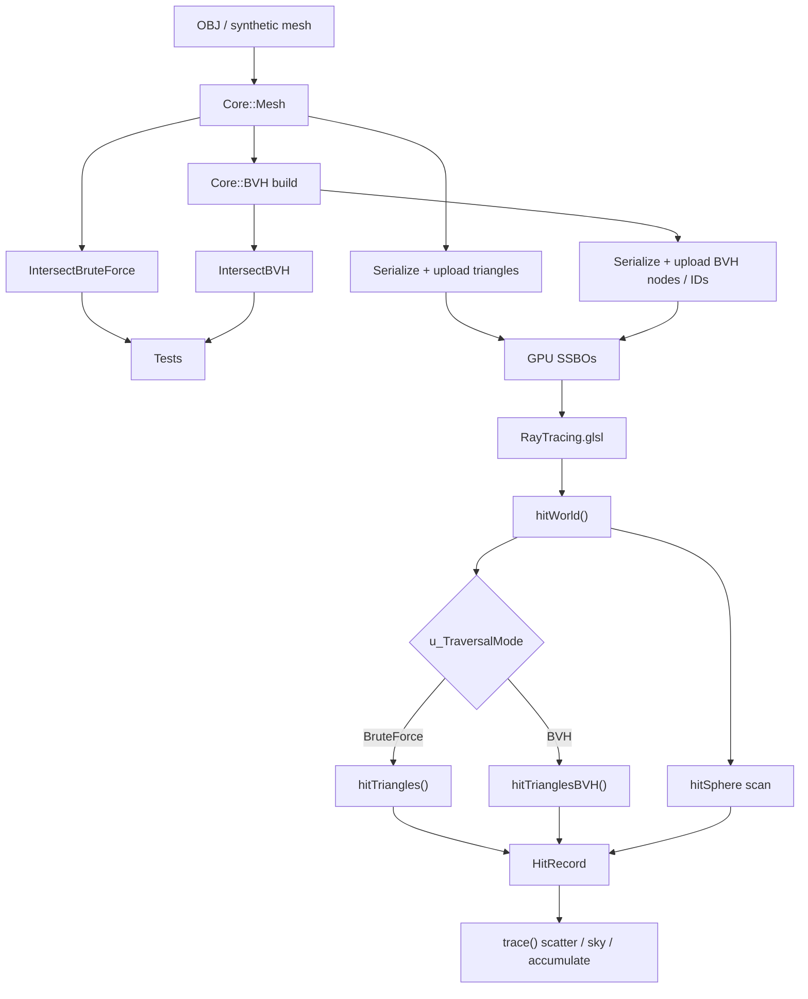
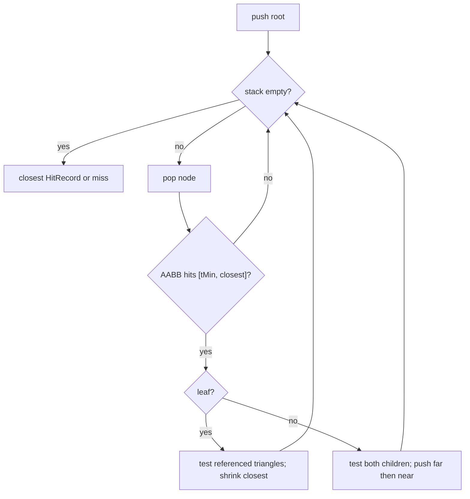

# RayTracer

A C++ / OpenGL 4.6 compute-shader path tracer built as a university project
to implement and evaluate a Bounding Volume Hierarchy (BVH) for triangle
intersection.

The project is an implementation and experimental evaluation of an established
acceleration-structure approach (a binary, centroid-median-split BVH), not a
novel BVH algorithm. It answers a concrete question:

> How does a BVH affect the cost of ray-triangle intersection compared with
> brute-force traversal as scene complexity increases?

Measured results live in [`Analysis/M10-BVH-Analysis.md`](Analysis/M10-BVH-Analysis.md).
This README does not repeat those tables.

## What is implemented

- GPU path tracing (diffuse / Lambertian scatter, progressive accumulation)
- Sphere geometry (original renderer, still functional)
- CPU triangle / AABB / mesh types and Möller–Trumbore intersection
- Wavefront OBJ import (positions and faces only)
- CPU BVH construction (binary, centroid median split, default leaf size 4)
- CPU brute-force and CPU BVH traversal, cross-checked against each other
- GPU triangle buffers and GPU brute-force triangle traversal
- GPU BVH upload and iterative compute-shader traversal
- Runtime toggle between GPU brute-force and GPU BVH (press **B**)
- Separate CPU/GPU benchmark executable with CSV export
- Reproducible analysis of one committed benchmark run

Not implemented, by design: SAH construction, dynamic / refitting BVHs,
textures, a material system, hardware ray-tracing APIs.

## Milestone progression

```
brute force spheres
    → triangle meshes          (M1)
    → OBJ import               (M4)
    → CPU BVH construction     (M5)
    → CPU BVH traversal        (M6)
    → GPU triangles            (M7)
    → GPU BVH                  (M8)
    → benchmarking             (M9)
    → analysis                 (M10)
    → cleanup / documentation  (M11)
```

M2 was merged into M1. M3 is the CPU brute-force triangle reference used to
validate the CPU BVH. Full milestone records are in
[`specs/milestones.md`](specs/milestones.md).

## Architecture

`Core` is a static library. Three executables link against it:

| Target | Role |
|---|---|
| `Core` | Window/event/camera, thin OpenGL helpers, CPU geometry, OBJ import, BVH |
| `App` | Interactive scene, GPU upload, compute dispatch, present pass |
| `Tests` | CPU geometry / BVH correctness (no OpenGL context) |
| `Benchmark` | CPU and GPU timing harness, CSV export |

`Analysis/` is not a build target. It is a Python script that reads the
committed CSV and regenerates tables and plots.



Authoritative detail: [`specs/architecture.md`](specs/architecture.md).

### CPU vs GPU

| | CPU (`Core`) | GPU (`App/Shaders/RayTracing.glsl`) |
|---|---|---|
| Mesh / OBJ import | yes | no |
| BVH **build** | `Core::BVH` only | never |
| Triangle intersect | `Triangle::Intersect` | `hitTriangle()` |
| Brute-force traversal | `IntersectBruteForce` | `hitTriangles()` |
| BVH traversal | `IntersectBVH` | `hitTrianglesBVH()` |
| Path tracing | no | `trace()` |

CPU types are independent of OpenGL and are tested without a window. GPU
types are explicit upload structs (`AppGPUTriangle`, `AppGPUBVHNode`) that
match GLSL `std430` layout. `Core::Triangle` (36 bytes) and `Core::BVHNode`
(40 bytes) are never `memcpy`'d to the GPU.

For a static scene the pipeline is **build once → upload once → render many
frames**. The BVH is not rebuilt per frame.

The `Benchmark` target duplicates those upload structs in
`Benchmark/Source/GpuUpload.h` so the interactive `AppLayer` path did not
have to be edited for measurement. Both copies are `static_assert`-checked
against the same offsets; they are not a shared header.

### GPU buffers and layout

Image unit 0 and SSBO binding 0 are different namespaces. Both are in use.

| Binding | Qualifier | Contents |
|---|---|---|
| image 0 | `rgba32f` | Accumulation texture |
| SSBO 0 | `std140` | Spheres (`Core::Sphere`, 16-byte coincidence — do not copy this pattern) |
| SSBO 1 | `std430` | Triangles (`vec3` + pad × 3, stride 48) |
| SSBO 2 | `std430` | BVH nodes (`boundsMin`/`boundsMax` + 4 `uint`s, stride 48; `firstPrimitive` is at offset **28**) |
| SSBO 3 | `std430` | BVH primitive → triangle ID (`uint` array, stride 4) |

The BVH node padding is not “pad every `vec3` to 16 bytes”. A scalar after a
`vec3` only needs 4-byte alignment, so `firstPrimitive` sits at offset 28,
not 32. Details and diagrams: [`specs/gpu-integration.md`](specs/gpu-integration.md).

BVH leaves store a range into buffer 3; those IDs index buffer 1. Triangle
geometry is not duplicated into the BVH buffers.

### Traversal

CPU and GPU BVH traversal use the same iterative traversal strategy: explicit stack,
re-test the node AABB against the current closest hit, scan leaf triangles,
push the farther child first so the nearer child is visited first.



Documented semantic difference: CPU `IntersectBVH` resolves a bit-identical
distance tie to the lower triangle ID. The GPU paths resolve an exact tie by
whichever triangle that path visits first. This had no observed effect on
the committed GPU pixel checks (bit-exact for every scene where both GPU
modes completed).

## Build

Requires C++23, CMake ≥ 3.10, OpenGL 4.6, and the dependencies fetched by
`Dependencies.cmake` (GLFW, GLAD, GLM).

```bash
cmake -S . -B build
cmake --build build
```

Individual targets: `App`, `Tests`, `Benchmark`.

## Run the interactive application

The application loads shaders and `App/Assets/` **relative to the working
directory**. Run it from `App/`:

```bash
cd App
../build/App/App
```

On a hybrid laptop the default OpenGL context may be the iGPU. To use a
discrete NVIDIA GPU (the GPU that produced the committed analysis dataset):

```bash
cd App
__NV_PRIME_RENDER_OFFLOAD=1 __GLX_VENDOR_LIBRARY_NAME=nvidia ../build/App/App
```

The same environment variables apply to `Benchmark` when a specific GPU is
required.

Controls:

- Mouse / keyboard: editor camera (`EditorCameraController`)
- **B**: toggle triangle traversal (`BruteForce` ↔ `BVH`) and reset accumulation

The default scene is two spheres, a hand-authored quad, and an imported
tetrahedron (`App/Assets/Tetrahedron.obj`). Bunny and Armadillo are
benchmark assets, not the interactive default.

## Tests

CPU-only. No window or GL context.

```bash
cmake --build build --target Tests
./build/Tests/Tests
# or
ctest --test-dir build
```

Asset paths are injected at configure time (`TESTS_ASSET_DIR`); the test
binary can be run from any working directory.

## Benchmark

Do **not** rerun the full benchmark just to refresh numbers. The committed
dataset is `Benchmark/Results/benchmark_results.csv` (NVIDIA GeForce RTX
3050 Ti Laptop GPU, `2026-09-20T22:04:47Z`). Analysis is derived from that
file.

Reproduction commands (the tool itself; a new run overwrites the default
CSV unless `--output` is set):

```bash
cmake --build build --target Benchmark

# Full CPU + GPU run (overwrites Benchmark/Results/benchmark_results.csv)
./build/Benchmark/Benchmark

# Smoke test — not report-quality
./build/Benchmark/Benchmark --quick

# CPU only (no OpenGL context)
./build/Benchmark/Benchmark --skip-gpu

# GPU only
./build/Benchmark/Benchmark --skip-cpu

# Write somewhere other than the committed file
./build/Benchmark/Benchmark --output /tmp/benchmark_results.csv
```

`Benchmark` resolves `App/Shaders/RayTracing.glsl` and `App/Assets/*.obj`
through `BENCHMARK_APP_DIR`, so it can be launched from any working
directory.

Default GPU brute-force ceiling: 20,000 triangles. Bunny (69,630) and
Armadillo (212,574) therefore have GPU BVH rows only. That ceiling is a
fixed, hand-picked constant, not a measured break-even point.

Measured categories are kept separate: model load, BVH **build**, GPU
**upload**, and **render** time. GPU render time is a whole-frame
`GL_TIME_ELAPSED` query of the compute dispatch, not an isolated traversal
timer. See [`specs/benchmarking.md`](specs/benchmarking.md).

## Analysis

Regenerate tables and plots from the committed CSV (stdlib Python only):

```bash
python3 Analysis/Source/generate_analysis.py
```

This writes `Analysis/Results/tables/*.csv` and `Analysis/Results/plots/*.svg`.
It does not render, traverse, or rebuild a BVH.

Read the findings in [`Analysis/M10-BVH-Analysis.md`](Analysis/M10-BVH-Analysis.md).
Every GPU number in that document is from the NVIDIA run above. An earlier
AMD iGPU run is mentioned only where a *qualitative* difference is itself
an observation; AMD and NVIDIA timings are never mixed into one figure.

High-level measured observations (see the analysis for numbers, caveats,
and the fact/hypothesis/limitation split):

- CPU brute force scales linearly with triangle count on the synthetic scenes.
- CPU and GPU BVH are faster than their own brute-force references wherever
  both modes completed.
- CPU BVH cost depends on scene structure, not only triangle count (Bunny /
  Armadillo vs scattered synthetic meshes).
- That structure effect is only partly reproduced on the NVIDIA GPU in this
  dataset.
- GPU brute force was not dispatched above 10,000 triangles; no speedup is
  reported for the skipped scenes.
- Measured one-time build + upload exceeds a single GPU BVH frame. That this
  cost amortizes over many static-scene frames is a derived projection from
  those measurements, not a separately timed multi-frame run. This is not a
  claim about dynamic geometry.

## Specifications

| File | Contents |
|---|---|
| [`specs/project.md`](specs/project.md) | Goal, pipeline, non-goals |
| [`specs/architecture.md`](specs/architecture.md) | Modules, data flow, constraints |
| [`specs/geometry.md`](specs/geometry.md) | Triangle / AABB / mesh |
| [`specs/model-import.md`](specs/model-import.md) | OBJ import |
| [`specs/bvh.md`](specs/bvh.md) | Construction, invariants, CPU traversal |
| [`specs/gpu-integration.md`](specs/gpu-integration.md) | Buffers, layout, GPU traversal |
| [`specs/benchmarking.md`](specs/benchmarking.md) | What is measured and how |
| [`specs/milestones.md`](specs/milestones.md) | M0–M11 record |
| [`specs/AGENTS.md`](specs/AGENTS.md) | Implementation philosophy for contributors |
