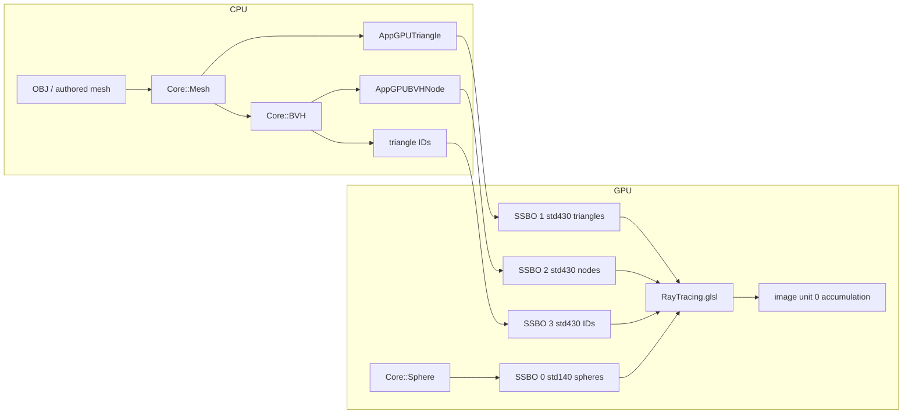

# Current Architecture

## Repository Structure

    Core/
        CMakeLists.txt
        Source/
            Core/
                Application
                Camera
                Event
                InputEvents
                Layer
                Window
                WindowEvents
                Renderer/
                    GLUtils
                    Renderer          (OpenGL wrappers: Texture, Framebuffer, StorageBuffer)
                    Shader
                    Sphere
                    Ray
                    AABB
                    Triangle
                    Mesh
                    TriangleTraversal
                    ModelImporter
                    BVH
        vendor/
            stb/

    App/
        CMakeLists.txt
        Assets/
            Tetrahedron.obj
            bunny.obj
            armadillo.obj
        Shaders/
            Vertex.glsl
            Fragment.glsl
            RayTracing.glsl
        Source/
            AppLayer
            EditorCameraController
            Main

    Tests/
        CMakeLists.txt
        Source/
            TestFramework
            AABBTests
            TriangleTests
            MeshTests
            TraversalTests
            ModelImporterTests
            BVHTests
            BVHTraversalTests
            Main
        Assets/
            Triangle.obj
            Quad.obj

    Benchmark/
        CMakeLists.txt
        Source/
            Main
            CpuBenchmark
            GpuBenchmark
            GpuContext
            GpuUpload
            Scenes
            ...
        Results/
            benchmark_results.csv

    Analysis/
        M10-BVH-Analysis.md
        Source/
            generate_analysis.py
            svgplot.py
        Results/
            tables/
            plots/

    specs/

`Renderer/` holds two distinct groups. `Renderer.h`, `Shader.h`, and `GLUtils.h`
are OpenGL wrappers in the `Renderer` namespace. `Sphere.h`, `Ray.h`, `AABB.h`,
`Triangle.h`, `Mesh.h`, `TriangleTraversal.h`, `ModelImporter.h`, and `BVH.h`
are geometry/acceleration-structure types and algorithms in the `Core`
namespace and do not include OpenGL.

`Tests` is an executable that links `Core` and validates the CPU geometry
without an OpenGL context. It adds no third-party dependencies and is
registered with CTest.

`Benchmark` is a separate executable that links `Core`, creates its own hidden
OpenGL context, and drives the existing compute shader for measurement. It is
not part of the interactive `App` and cannot be triggered by loading a model
in the windowed renderer.

`Analysis` is not a CMake target. It reads the committed CSV and regenerates
derived tables and plots.

## Module Dependency

The dependency direction is:

    App     Tests     Benchmark
     |        |           |
     +--------+-----+-----+
                    |
                    v
                  Core

`Core` is built as a static library.

`App`, `Tests`, and `Benchmark` link against `Core`.

`Core` must not depend on `App`, `Tests`, or `Benchmark`.

`Analysis` depends only on the committed CSV and the Python standard library.

## Module Boundary Rules

### GPU buffer abstraction

Storage-buffer creation and upload is a reusable OpenGL concern and belongs in
`Core`, in the existing `Renderer` namespace, alongside `CreateTexture`.

The abstraction must remain intentionally thin and provide only:

- create storage buffer
- upload / replace buffer data
- bind buffer to an SSBO binding point
- destroy / release the buffer

It must not grow into a general-purpose renderer or resource-management
framework. There is no resource registry, no handle table, no lifetime manager.

`AppLayer` remains responsible for deciding *what* is uploaded, *which* buffers
exist, *which* binding points they use, scene ownership, BVH ownership,
traversal mode, and render configuration.

`Benchmark` creates the same buffer kinds through the same `Renderer` helpers,
using its own upload structs (see "GPU upload duplication" below).

### CPU geometry must not depend on OpenGL

`Core` CPU geometry and the BVH must be usable without an OpenGL context.

Specifically, the following must not include OpenGL headers and must not
reference `GLuint`, SSBOs, GLSL types, binding points, or shader concepts:

- triangle representation
- AABB
- mesh representation
- model importing
- BVH construction, storage, and CPU traversal

The flattened BVH is a plain CPU array of plain structs. Turning it into GPU
buffers is `AppLayer`'s job (and, for measurement, `Benchmark`'s job).

This keeps the BVH independently testable without a window or a GL context.

## Core Responsibilities

`Core` provides:

- Application, window, and event abstractions
- Camera abstraction
- OpenGL utility and resource abstractions (`Texture`, `Framebuffer`,
  `StorageBuffer`, shader compilation)
- Sphere representation
- CPU triangle / AABB / mesh types
- CPU ray-triangle and ray-AABB intersection
- Wavefront OBJ import into `Core::Mesh`
- BVH construction, flattened storage, and statistics
- CPU brute-force and CPU BVH traversal

New reusable ray-tracing functionality should remain in `Core`.

## App Responsibilities

`App` provides:

- Application entry point
- Application layer
- Interactive scene setup and ownership
- Renderer orchestration (uniforms, bindings, dispatch, present)
- Shader resources
- Editor camera controller
- Traversal-mode toggle

## Benchmark Responsibilities

`Benchmark` provides:

- CLI orchestration
- Synthetic scene generation and real-model loading
- CPU traversal timing (`IntersectBruteForce` / `IntersectBVH`)
- GPU render timing of the existing compute shader
- CSV export

Benchmark orchestration does **not** live in `App`. Running a measurement is
always an explicit invocation of the `Benchmark` executable.

## Tests Responsibilities

`Tests` validates CPU geometry, import, BVH construction, and CPU traversal.
It never creates a window or an OpenGL context.

## Responsibility Split

The authoritative split is:

    Core
        platform / window / event abstractions
        OpenGL utility and resource abstractions
        CPU geometry
        BVH construction and CPU traversal
        model importing

    App
        AppLayer
        interactive scene setup
        renderer orchestration
        shader configuration
        traversal-mode selection

    Tests
        CPU correctness suite

    Benchmark
        measurement harness
        CSV export

    Analysis
        interpretation of the committed CSV

## Renderer

There is no `Renderer` class.

`Renderer` is a C++ *namespace* in `Core` containing free functions over raw
OpenGL handles. It provides `Texture`/`Framebuffer` helpers (`Renderer.h`),
shader compilation (`Shader.h`), and the thin `StorageBuffer` API. It does
not own the scene, the camera, the accumulation state, or the dispatch.

Ray-tracing orchestration lives in `App`, in `AppLayer`:

    AppLayer                                (App)
        |
        +-- owns scene data (spheres, mesh, CPU BVH)
        +-- owns GPU buffer + texture handles
        +-- owns accumulation state (frame index)
        +-- owns traversal mode
        +-- sets uniforms and binding points
        +-- issues glDispatchCompute
        |
        +-- calls --> Renderer:: free functions   (Core)
        |                 CreateComputeShader
        |                 CreateTexture
        |                 CreateStorageBuffer / BindStorageBuffer
        |
        v
    RayTracing.glsl

`AppLayer::OnRender()` is the per-frame entry point. It is invoked by
`Core::Application::Run()` through the `Core::Layer` interface.

The compute shader owns most of the ray-tracing logic.

Any specification text that refers to "the renderer" describes this behaviour,
not a class. New orchestration responsibilities belong in `AppLayer`; new
reusable primitives belong in `Core`.

## Data Flow

For a static scene:

    Load / author geometry
        |
        v
    Build mesh
        |
        v
    Build BVH          (CPU, once)
        |
        v
    Serialize + upload (CPU → GPU, once)
        |
        v
    Render many frames (GPU; bind buffers, do not rebuild)

## GPU Scene Representation

### Spheres — binding 0, `std140`

    struct Sphere {
        vec3 center;
        float radius;
    };

    layout (std140, binding = 0) buffer SphereBuffer {
        Sphere spheres[];
    };

    uniform int u_SphereCount;

The sphere SSBO uses `std140` and binding point 0. It works because
`Core::Sphere` is 16 bytes and the `std140` array stride for this particular
struct is also 16.

This is specific to this struct shape and must not be generalised. The existing
sphere buffer, its `std140` layout, its binding point, and `hitSphere()` remain
unchanged unless a later specification explicitly requires otherwise. New SSBOs
use their own binding points and prefer `std430`; see `gpu-integration.md`.

### Triangles — binding 1, `std430`

CPU `Core::Triangle` is 36 bytes and is not uploaded. The upload struct is
three `vec3` + explicit pad floats (48-byte stride). See `gpu-integration.md`
and the comment block above `AppGPUTriangle` in `App/Source/AppLayer.cpp`.

### BVH — bindings 2 and 3, `std430`

CPU `Core::BVHNode` is 40 bytes and is not uploaded. The upload node is 48
bytes; `firstPrimitive` is at offset 28. Primitive references are a plain
`uint` array (4-byte stride). Leaves index that array; those IDs index the
triangle buffer. Triangle geometry is not duplicated.

Image unit 0 and SSBO binding 0 are separate binding namespaces.

## GPU upload duplication

`AppLayer.cpp` defines `AppGPUTriangle` / `AppGPUBVHNode` in an anonymous
namespace. `Benchmark/Source/GpuUpload.h` carries a hand-synchronized copy so
M9 could measure the existing shader without editing `AppLayer`. Both sides
use the same `static_assert` offsets. This is documented duplication, not a
shared header.

## Ray and Hit Representation

The shader defines:

    struct Ray {
        vec3 origin;
        vec3 dir;
    };

    struct HitRecord {
        vec3 p;
        vec3 normal;
        float t;
        bool frontFace;
    };

These representations should remain conceptually unchanged unless a concrete
requirement requires otherwise.

The path-tracing code does not need to know whether the intersection came from
a sphere or a triangle, or which triangle traversal mode produced it.

## Intersection Pipeline

                     Ray
                      |
                      v
                 hitWorld()
                      |
              +-------+-------+
              |               |
          Spheres          Meshes
                              |
                        Traversal Mode
                        /           \
                 BruteForce         BVH
                      |               |
                      +-------+-------+
                              |
                          HitRecord
                              |
                           trace()

`hitWorld()` still scans every sphere linearly. Triangle work is either the
brute-force scan (`hitTriangles()`) or iterative BVH traversal
(`hitTrianglesBVH()`), selected by `u_TraversalMode` (press **B** in `App`).
Changing the mode resets frame accumulation.

## Architecture Constraints

Do not turn the project into a general-purpose game engine.

Avoid introducing:

- ECS
- Scene graph
- Material framework
- Generic geometry framework
- Generic acceleration-structure framework

unless they become genuinely necessary.

The project should remain small and understandable.

## Shader Location

The ray-tracing shader is:

    App/Shaders/RayTracing.glsl

Do not move the shader solely for architectural cleanliness.

`App` resolves shader and asset paths relative to the working directory and
must be launched from `App/`. `Tests` and `Benchmark` use configure-time
absolute paths and can be run from any working directory.

## Completed Growth Path

    Existing spheres
          |
          v
    CPU triangle geometry
          |
          v
    CPU brute-force triangles
          |
          v
    CPU BVH
          |
          v
    GPU triangle brute force
          |
          v
    GPU BVH traversal
          |
          v
    Benchmark + analysis

Each stage remains independently understandable and testable.
