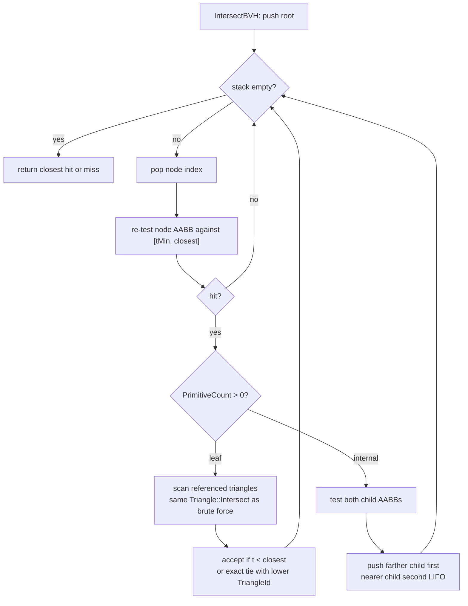

# BVH Specification

## Objective

Implement a binary Bounding Volume Hierarchy over triangle primitives.

The BVH is used to reduce the number of triangle intersection tests performed for each ray.

## BVH Type

The initial implementation uses:

- Binary BVH
- Axis-aligned bounding boxes
- Centroid-based splitting
- Median partitioning
- Configurable maximum leaf size

No Surface Area Heuristic (SAH) is required for the initial implementation.

The algorithm should remain simple enough to explain in a university project.

## OpenGL Independence

`Core::BVH` must be completely independent of OpenGL.

BVH construction, storage, statistics, and CPU traversal must not:

- include OpenGL headers
- reference `GLuint` or any GL type
- reference SSBOs, binding points, or buffer objects
- reference GLSL types or shader concepts
- depend on any renderer type

The BVH produces a plain CPU array of plain structs. Converting that array into
GPU buffers and uploading it is `AppLayer`'s responsibility.

The BVH must therefore be constructible and testable without a window, without
a GL context, and without the `App` target.

## Primitive

Each BVH primitive contains or references:

- Triangle ID
- AABB
- Centroid

The BVH must not duplicate complete triangle geometry.

## Node

A BVH node represents either an internal node or a leaf.

Conceptually:

    Node
        bounds : AABB

        Internal:
            left child
            right child

        OR

        Leaf:
            first primitive
            primitive count

The exact C++ representation is implementation-defined.

The representation must be suitable for flattening and uploading to the GPU.

## Construction

Given a primitive range:

### Step 1 — Calculate Bounds

Calculate the AABB containing all primitive bounds in the current range.

### Step 2 — Check Leaf Condition

If the primitive count is less than or equal to the configured leaf size, create a leaf.

### Step 3 — Calculate Centroid Bounds

Calculate the AABB containing all primitive centroids.

### Step 4 — Select Split Axis

Calculate:

    extent = centroidBounds.max - centroidBounds.min

Select the axis with the largest extent.

The intended behavior is:

    X if extent.x is largest
    Y if extent.y is largest
    Z otherwise

The exact tie-breaking behavior should be deterministic.

### Step 5 — Partition Primitives

Partition primitives by centroid along the selected axis.

### Step 6 — Split at Median

Split the primitive range at the median.

Both resulting ranges must contain at least one primitive.

### Step 7 — Recurse

Construct the left and right child nodes.

## Default Leaf Size

The initial default leaf size is:

    4 triangles

The leaf size must be configurable.

The implementation should make it possible to benchmark different leaf sizes later.

## Degenerate Cases

The implementation must handle:

- Zero primitives
- One primitive
- All centroids equal
- Zero centroid extent
- Failed partition
- Degenerate triangles

If a valid split cannot be produced, create a leaf rather than recursing indefinitely.

Construction must always terminate.

## Primitive Ordering

The construction algorithm may reorder primitive references during partitioning.

If this occurs, the original triangle data must remain valid.

The mapping from BVH primitive reference to triangle ID must remain correct.

## Flattened Representation

The GPU representation must not contain CPU pointers.

The tree must be flattened into an array.

Children are represented by integer indices.

For example:

    nodes[0] -> root
    nodes[1] -> left child
    nodes[2] -> right child
    ...

The exact flattening order is implementation-defined but must be deterministic.

## BVH Invariants

For every internal node:

    node.bounds contains left.bounds
    node.bounds contains right.bounds

For every leaf:

    leaf.bounds contains every referenced triangle

Globally:

    root.bounds contains every triangle

Every triangle must occur in exactly one leaf.

No triangle may be lost or referenced by multiple leaves unless explicitly intended by the representation.

## CPU Traversal

Implement a CPU BVH traversal path for testing.

CPU traversal must:

1. Test the root AABB.
2. Traverse intersected child nodes.
3. Test triangles in leaves.
4. Maintain the closest hit.
5. Respect `tMin` and `tMax`.

Traversal is iterative so that its structure resembles the GPU traversal.

## Brute-Force Reference

Implement a CPU brute-force triangle traversal:

    for every triangle:
        intersect triangle
        keep closest hit

This implementation serves as the correctness reference.

## Correctness Requirement

For the same ray:

    BVH result == brute-force result

within a documented floating-point tolerance.

The BVH must not change the geometric result.

Specifically, the BVH must not:

- Miss a valid intersection.
- Return a farther hit when a closer hit exists.
- Return a different triangle for an otherwise identical ray.
- Produce invalid intersection distances.

## Statistics

The BVH should expose or make available:

- Node count
- Leaf count
- Maximum depth
- Minimum leaf size
- Maximum leaf size
- Average leaf size
- Primitive count

These values are useful for:

- Debugging
- Benchmarking
- Report analysis
- Understanding the generated hierarchy

## Complexity

For `N` triangles, brute-force traversal performs O(N) triangle intersection tests per ray.

BVH traversal is intended to reduce the number of triangle intersection tests by rejecting groups of triangles through AABB tests.

Actual performance must be measured rather than assumed.

## Future Extensions

The architecture may later support:

- SAH construction
- Different leaf sizes
- Different split strategies
- BVH visualization
- BVH refitting

These are not part of the initial implementation.
