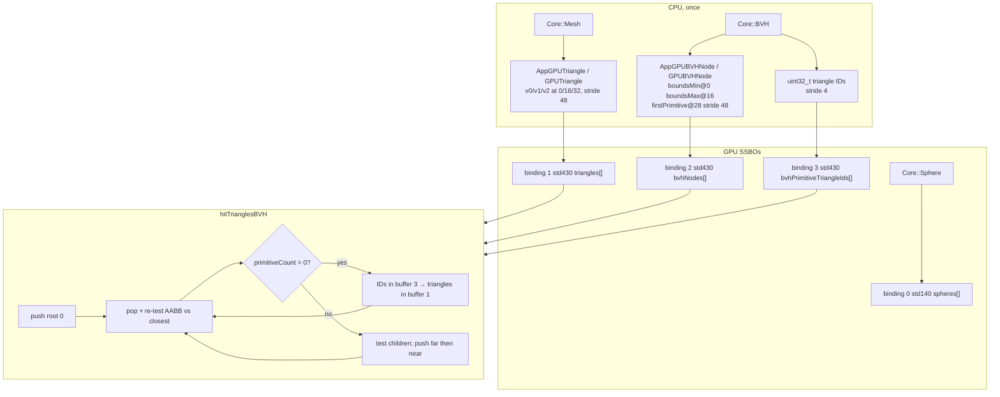

# GPU Integration Specification

## Objective

Integrate triangle geometry and BVH traversal into the existing OpenGL compute-shader path tracer.

## Existing Shader Interface

The shader contains:

    bool hitWorld(Ray r, float tMin, float tMax, out HitRecord rec)

`hitWorld()` is the scene-intersection entry point. It scans spheres, then
dispatches triangle work to either brute-force or BVH traversal according to
`u_TraversalMode`.

The path-tracing function `trace()` does not need to know whether the
intersection came from:

- A sphere
- A triangle
- Brute-force traversal
- BVH traversal

## Existing Shader

The ray-tracing shader is:

    App/Shaders/RayTracing.glsl

The shader contains:

    Sphere
    Triangle
    BVHNode
    Ray
    HitRecord

and the functions:

    hitSphere()
    hitTriangle()
    hitTriangles()
    hitAABB()
    hitTrianglesBVH()
    hitWorld()
    trace()

New functionality should integrate with this existing structure rather than
unnecessarily rewriting the complete shader.

## GPU Geometry

Triangle data must be uploaded to GPU-accessible buffers.

The initial triangle representation should contain enough information to perform:

- Triangle intersection
- Surface normal calculation

Avoid uploading attributes that are not currently required.

## CPU Structures vs GPU Buffer Layouts

CPU data structures and GPU buffer layouts are separate concerns and must be
treated as such.

A C++ struct containing `glm::vec3` does **not** automatically match its GLSL
representation. `sizeof(glm::vec3)` is 12 bytes with 4-byte alignment; a GLSL
`vec3` has 16-byte alignment. Any struct mixing `vec3` with other members will
differ between the two unless deliberately arranged.

CPU geometry types are optimised for CPU traversal and testing. GPU types are
optimised for shader access and layout rules. Where the two differ, the CPU type
is serialised into an explicit upload representation rather than being
`memcpy`-ed and hoped for.

### Required documentation

Before implementing any GPU-facing structure, document:

- CPU layout (member order, offsets, `sizeof`, alignment)
- GLSL layout (block layout qualifier, member offsets)
- Alignment
- Array stride
- Serialisation / upload representation (direct upload, or explicit conversion)
- Buffer type
- Binding index

### Layout qualifier

New SSBOs prefer `std430`.

`std430` does not round scalar and `vec2` array strides up to 16 bytes, which
matters for index arrays such as BVH primitive references. Under `std140` a
`uint indices[]` block consumes 16 bytes per element while the CPU writes 4,
which corrupts data silently rather than raising an error.

The existing sphere SSBO keeps `std140` and binding point 0.

### Static validation

Layout agreement must be validated at compile time where practical, using
`static_assert` on `sizeof` and `offsetof` for every upload representation.

Do not rely on accidental `sizeof` compatibility. The current sphere buffer
happens to match by coincidence; that coincidence is not a pattern to repeat.

## GPU Buffer Abstraction

Storage-buffer creation and upload is provided by a thin set of free functions
in `Core`'s `Renderer` namespace: create, upload/replace, bind to an SSBO
binding point, destroy.

It is intentionally minimal. See `architecture.md`, "Module Boundary Rules".

`AppLayer` decides what is uploaded, which buffers exist, and which binding
points they use.

## GPU BVH

The flattened BVH is uploaded as an array of nodes.

A node must provide enough information to:

- Test its AABB
- Determine whether it is a leaf
- Find child nodes
- Find referenced triangles

No CPU pointers may be present in GPU data.

All references must use GPU-compatible integer indices.

## Traversal Mode

The renderer must support two triangle traversal modes:

    BruteForce
    BVH

The mode must be selectable without recompiling the application.

The simplest compatible mechanism should be preferred, such as:

- Uniform
- Render configuration owned by `AppLayer`

The exact mechanism should follow the existing architecture. `AppLayer` already
sets every uniform inline in `OnRender()`, so a `u_TraversalMode` uniform set
from an `AppLayer`-owned enum is the smallest compatible mechanism.

Changing traversal mode must reset frame accumulation, otherwise two different
images are blended into one accumulation buffer.

## Brute-Force GPU Traversal

For every ray:

    closest = tMax

    for every triangle:
        test intersection

        if hit and t < closest:
            update closest hit

This is the GPU correctness reference for BVH traversal.

## GPU BVH Traversal

For every ray:

1. Initialize the traversal stack.
2. Test the root AABB.
3. Pop a node.
4. If the node is a leaf:
   - Test referenced triangles.
5. If the node is internal:
   - Test child AABBs.
   - Push intersected children.
6. Continue until the stack is empty.
7. Return the closest hit.

Traversal must be iterative.

Do not depend on recursive GLSL functions.

## Traversal Stack

The implementation must define a maximum stack capacity appropriate for the generated BVH.

The implementation must handle stack overflow safely.

A stack overflow must not cause undefined behavior or GPU memory corruption.

The expected maximum BVH depth should be considered when selecting the stack size.

## Child Traversal Order

If both child AABBs are hit, the traversal may prioritize the child with the smaller entry distance.

This is not required for correctness but may improve early closest-hit discovery.

If implemented, the behavior should be documented.

## Closest Hit

Both brute-force and BVH traversal must produce the same `HitRecord` semantics.

The closest valid intersection must be returned.

The existing path tracer should then perform diffuse scattering exactly as before.

## Sphere Compatibility

Sphere intersection must remain functional.

Adding triangle/BVH support must not require converting all existing spheres into triangles.

The renderer may maintain separate sphere and triangle storage.

## GPU Data Lifecycle

For static models:

    Load model
        |
    Build mesh
        |
    Build BVH
        |
    Flatten BVH
        |
    Upload triangle data
        |
    Upload BVH data
        |
    Render many frames

The BVH must not be rebuilt every frame.

## GPU Validation

For the same scene and camera:

    GPU brute-force
            vs
    GPU BVH

must produce equivalent intersections and visually equivalent rendered output within a documented floating-point tolerance.

## CPU/GPU Validation

Before relying on GPU BVH results, validate the BVH itself on the CPU.

The recommended validation chain is:

    CPU brute force
            |
            v
        CPU BVH
            |
            v
    GPU brute force
            |
            v
        GPU BVH

Each stage should be validated against the previous correctness reference.

## Existing Path Tracer

The following existing behavior should remain unchanged unless required:

- Camera ray generation
- Random sampling
- Diffuse scattering
- Attenuation
- Sky color
- Frame accumulation

Do not redesign the path tracer as part of BVH integration.

## GPU Data Layout and Traversal

Leaf nodes do not store triangle vertices. They store a range into buffer 3;
those IDs index buffer 1.

Stack: fixed `int stack[64]`. Overflow drops the push (incomplete traversal)
instead of writing out of bounds. Median-split construction bounds depth by
`ceil(log2(N))`, so 64 exceeds any scene this project builds. That bound is
about tree *depth*, not a claim that traversal time is `O(log N)`.
